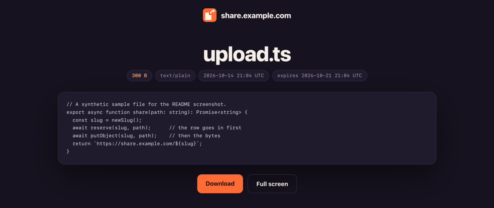

<p align="center"></p>

<h1 align="center">Share</h1>

<p align="center"><b>One file, one link, on your own domain.</b><br>A self-hosted file link service on Cloudflare: a read-only Worker, a private R2 bucket, and a CLI that is the only thing that can write.</p>

---

You want to send someone a screen recording, a PDF, or a log file, and you want a link back. The hosted tools that do this keep your files on their servers, put their brand on your link, and decide how long it lives. Share gives you the same one-command flow on `share.yourdomain.com`, with the files in your own Cloudflare account and nothing in between.

```console
$ share demo.mp4 --expires 7d
https://share.example.com/7HqXk2mPzR4tYb9wNcVd3e   (copied)
```

The link opens a preview page: video, images, audio and PDFs play in the browser, text and code show as text, and anything else gets a download button.

<p align="center"></p>

## How it works

```
                 your machine                              Cloudflare
  ┌───────────────────────────────────┐     ┌───────────────────────────────────────┐
  │ share demo.mp4                    │     │                                       │
  │  1. INSERT row ── D1 API token ───┼────▶│  D1  shares table (slug, name, size…) │
  │  2. PUT bytes ─── R2 bucket token ┼────▶│  R2  object named <slug>              │
  └───────────────────────────────────┘     │                ▲          ▲           │
                                            │          SELECT│      GET │           │
  ┌───────────────────────────────────┐     │         ┌──────┴──────────┴───────┐   │
  │ anyone with the exact link        │────▶│         │ Worker: GET and HEAD    │   │
  └───────────────────────────────────┘     │         │ only, no credentials    │   │
                                            │         └─────────────────────────┘   │
                                            └───────────────────────────────────────┘
```

- **The Worker** (`src/`) answers `GET` and `HEAD` and nothing else. It looks up one row in D1 and streams one object from R2. Its code contains no write call, and a regression test flags the usual spellings of one if it ever appears.
- **The CLI** (`cli/share.ts`) is the only writer. It reserves a random slug in D1 first, then uploads the file to R2 under that slug, so a slug collision fails before anything is uploaded. If the upload fails it removes both the object and the row, and if that cleanup fails it tells you the one command that finishes it. `share rm` deletes the file first and the row second, so a failed removal can always be retried.
- **Links** are 22 random base58 characters, about 128 bits. Nothing lists them, `robots.txt` disallows everything, and every response says `noindex`.

| Route | What it returns |
|---|---|
| `/` | A landing page that lists nothing |
| `/<slug>` | The preview page |
| `/<slug>/raw` | The file itself, range requests supported; `?dl=1` downloads it |
| `/<slug>/view` | The file alone, filling the tab |

## What you need

- A Cloudflare account (the free plan works) with your domain added as an **active** zone, and no existing DNS record on the hostname you will use for Share.
- R2 turned on for the account. The first time, the dashboard asks you to enable R2 (it requires a payment method even on the free tier).
- [Bun](https://bun.sh) 1.3 or newer.
- About fifteen minutes.

Cost: Workers, D1 and R2 all have free tiers, and R2 has no egress fees, so a popular link doesn't run up a bandwidth bill.

## Setup

Every command runs from the repo folder. Replace `share.example.com` with the hostname you want.

### 1. Get the code

```bash
git clone https://github.com/danielmiessler/Share.git share
cd share
bun install
bunx wrangler login          # opens a browser to authorize wrangler on your account
```

### 2. Create the bucket and the database

```bash
bunx wrangler r2 bucket create share-files
bunx wrangler d1 create share-db
```

The second command prints a `database_id`. Copy it.

Leave the bucket private. Don't turn on its `r2.dev` URL or attach a custom domain to the bucket itself; the Worker is the only way in.

### 3. Fill in `wrangler.jsonc`

Three values are marked `←` in the file:

1. `routes[0].pattern`: your hostname, for example `share.yourdomain.com`.
2. `d1_databases[0].database_id`: the id from step 2.
3. `r2_buckets[0].bucket_name`: only if you named the bucket something else.

Keep `"workers_dev": false` and `"preview_urls": false`. They stop the Worker from also answering on a `*.workers.dev` address you would forget about.

### 4. Create the table and deploy

```bash
bunx wrangler d1 execute share-db --remote --file schema.sql
bunx wrangler deploy
```

Because the route is a custom domain, Cloudflare creates the DNS record and the certificate for you. Open `https://share.yourdomain.com/` and you should see the landing page.

### 5. Make the CLI's two credentials

The CLI never uses your wrangler login. It gets two narrow credentials, so a leaked laptop config can't touch your Workers, DNS or other buckets.

**A D1 token.** In the Cloudflare dashboard: *My Profile → API Tokens → Create Token → Create Custom Token*.

| Field | Value |
|---|---|
| Permissions | **Account** · **D1** · **Edit**, and nothing else (it covers every D1 database in the account; Cloudflare can't narrow it to one) |
| Account Resources | Include · your account |
| Client IP Address Filtering | Optional: your home or office IP |
| TTL | Optional: an end date, if you'd like to rotate it |

**An R2 token.** In the dashboard: *R2 Object Storage → Manage API tokens → Create Account API token* (or *Create User API token*).

| Field | Value |
|---|---|
| Permissions | **Object Read & Write** |
| Specify bucket(s) | **Apply to specific buckets only** · `share-files` |
| TTL | Optional |

Cloudflare shows the **Access Key ID** and **Secret Access Key** once. Copy both.

Your **Account ID** is on the right side of any zone's Overview page, or run `bunx wrangler whoami`.

### 6. Write the config file

```bash
mkdir -p ~/.config/share
cp config.env.example ~/.config/share/config.env
chmod 600 ~/.config/share/config.env
$EDITOR ~/.config/share/config.env
```

```ini
SHARE_URL=https://share.yourdomain.com
CLOUDFLARE_ACCOUNT_ID=…
SHARE_D1_DATABASE_ID=…
SHARE_D1_TOKEN=…
SHARE_R2_BUCKET=share-files
SHARE_R2_ACCESS_KEY_ID=…
SHARE_R2_SECRET_ACCESS_KEY=…
```

Keep each value on its own line with no trailing comment; `config.env.example` has the notes. The CLI refuses the file unless it is a regular file (not a symlink) that you own, with no permission bits for group or others. It checks mode bits, not ACLs, so don't grant ACLs on it; on Windows the file is read without the check, so protect it yourself. If every key is set in the environment, the file isn't opened at all. Any of the keys can also come from the environment, which wins over the file; `SHARE_CONFIG` points at a different file.

### 7. Put `share` on your PATH and check everything

```bash
mkdir -p ~/.local/bin && ln -s "$PWD/cli/share.ts" ~/.local/bin/share   # any directory on your PATH
share doctor
```

```console
ok    config ~/.config/share/config.env
ok    D1 token can query the shares table  (0 rows)
ok    R2 token can reach bucket share-files
ok    Worker answers at https://share.yourdomain.com
ok    Worker refuses writes  (POST → 405)
ok    unknown links are 404 and noindex
```

Every line should say `ok`. `doctor` checks that each credential reaches what it should and that the Worker refuses writes; it can't see token scopes or bucket settings, so do the hardening checklist below by eye once. Then share something:

```bash
echo "hello" > hello.txt && share hello.txt
```

## Using it

```bash
share report.pdf                  # link on stdout and on the clipboard
share demo.mp4 --expires 7d       # 30m, 24h, 7d, 2w; up to 365d
share notes.md --name "Q3 notes.md"   # show a different name on the page
share list                        # newest first; --limit 100, --json
share rm 7HqXk2mPzR4tYb9wNcVd3e   # deletes the file, then the row; a failed run can be retried
share prune                       # delete every expired share, row and file
```

An expired link returns `410 Gone` straight away, before `prune` runs. Run `prune` whenever you like, or put it in cron to reclaim the storage.

`--json` on an upload prints `{link, slug, filename, size, mime, expires_at}`, which makes the CLI easy to wire into a Finder action, a screenshot tool, or a shell function.

## Security model

The design goal is that the public half has nothing worth attacking. Here is what each piece does about the threats that matter.

| Threat | What stops it |
|---|---|
| Someone guesses or enumerates links | Slugs are 22 base58 characters from the system CSPRNG (≈128 bits). The Worker rejects anything that isn't a well-formed slug before it queries D1. There is no listing anywhere. |
| An uploaded HTML or SVG file runs script on your domain | `/raw` is served with `Content-Security-Policy: sandbox`, which gives the document an opaque origin and no script. PDFs are the one exception, because browsers won't start their PDF viewer in a sandbox; that viewer runs outside your page's origin. The preview page shows HTML and SVG as escaped text. All responses send `X-Content-Type-Options: nosniff`. |
| A crafted file name injects markup into the preview | Every value on the page is HTML-escaped, and the page CSP allows one stylesheet and one script, both by SHA-256 hash. An injected `<script>` would not run even if escaping failed. Tests cover hostile names. |
| A bug in the Worker becomes a write path | The Worker holds no credentials and its code only issues `SELECT` and R2 reads. A regression test flags the usual spellings of a write call. Workers bindings are capabilities, so the real protection is the code itself, which is small enough to read in one sitting. |
| The CLI's credentials leak | The D1 token can edit the account's D1 databases and nothing else. The R2 token can only touch the one bucket. Neither can deploy Workers, change DNS or read your other buckets. IP filtering and a TTL narrow them further. |
| SQL injection through file names | The CLI sends every value as a bound parameter to D1's query API. No value is ever spliced into SQL. |
| Links leak through referrers or search engines | `Referrer-Policy: no-referrer`, `X-Robots-Tag: noindex, nofollow`, and a `robots.txt` that disallows everything. Well-behaved crawlers honor these; they are not secrecy, the slug is. |
| Links pile up in logs | Workers observability is off in `wrangler.jsonc`, because invocation logs record every request URL, which means every link. Turn it on to debug, and off again after. |
| A forgotten second address | `workers_dev` and `preview_urls` are off, and the bucket has no public URL. |

What Share does not do, so you can decide whether it fits:

- **A link is a bearer secret.** Anyone who has it can open the file. There are no passwords or accounts.
- **Chat apps unfurl links.** When you paste a link into Slack or iMessage, their servers fetch the page to build a preview, so they see the file name, and for images and video the file itself.
- **Removal and expiry take effect on the next request.** Pages and files are sent `Cache-Control: no-store`, so neither Cloudflare nor the browser keeps a copy to serve later. A tab that already has the page open, or restores it with Back, keeps what it showed, and anyone who downloaded the file keeps it.
- **Text previews show the first 256 KB.** Larger text files say so and offer the download.

### Hardening checklist

- [ ] `workers_dev` and `preview_urls` are `false` in `wrangler.jsonc`, and the Worker has no other routes.
- [ ] Workers observability is off (or you have decided who can read those logs).
- [ ] The R2 bucket has public access off (no `r2.dev` URL, no custom domain on the bucket).
- [ ] The D1 token has exactly one permission, and the R2 token is limited to one bucket.
- [ ] `~/.config/share/config.env` is mode `600` and is not in any repo or synced folder.
- [ ] Optional: a WAF rate-limiting rule on your share hostname to slow down scanners.
- [ ] Optional: IP filtering and a TTL on the D1 token; rotate both tokens on a schedule.
- [ ] `share doctor` is all `ok`.

## Developing

```bash
bun test ./tests        # Worker and CLI tests, no network
bunx tsc --noEmit       # types
bunx wrangler dev       # run the Worker locally against local D1 and R2
```

To try the Worker locally, seed the local bindings (`wrangler d1 execute share-db --local --file schema.sql`, then insert a row and `wrangler r2 object put share-files/<slug> --local --file <path>`) and open `http://localhost:8787/<slug>`.

If you change the page CSS or the text-preview script, the test suite prints the new hashes; update `CSS_HASH` and `SCRIPT_HASH` in `src/share.ts` to match.

## License

MIT. See [LICENSE](LICENSE). Security reports: see [SECURITY.md](SECURITY.md).
